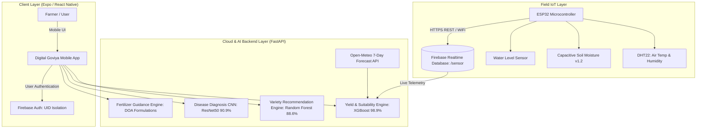

# External Domain Expert Validation Report
## Component 02: IoT Integrated Digital Dashboard & Smart Paddy Farming Advisory System
**Research Project ID:** R26-SE-007  
**Project Title:** Smart Paddy Farming System: An Integrated AI, IoT & Blockchain Research Platform  
**Target Organization / Validation Authority:** Paddy Marketing Board (PMB), Regional Office, Ampara, Sri Lanka  
**External Domain Expert:** Mr. K. A. P. P. Kumara (Assistant Regional Manager, PMB Ampara)  
**Evaluation Date:** 14th October 2026  
**Researcher:** P. A. N. D. Kumarasinghe (Student ID / Component Lead C02)  

---

## Table of Contents
1. [Introduction and Background](#1-introduction-and-background)
2. [Component Overview and System Architecture](#2-component-overview-and-system-architecture)
3. [Field IoT Telemetry and Hardware Implementation](#3-field-iot-telemetry-and-hardware-implementation)
4. [Sub-Component 1: AI-Driven Paddy Variety Recommendation](#4-sub-component-1-ai-driven-paddy-variety-recommendation)
5. [Sub-Component 2: Real-Time Field Suitability and Yield Prediction](#5-sub-component-2-real-time-field-suitability-and-yield-prediction)
6. [Sub-Component 3: Deep Learning Paddy Leaf Disease Diagnostics](#6-sub-component-3-deep-learning-paddy-leaf-disease-diagnostics)
7. [Sub-Component 4: Precision Fertilizer Dosage and Scheduling Guidance](#7-sub-component-4-precision-fertilizer-dosage-and-scheduling-guidance)
8. [Comprehensive Model Evaluation Metrics and Comparative Analysis](#8-comprehensive-model-evaluation-metrics-and-comparative-analysis)
9. [Farmer Field Demonstration and Usability Validation (10 Farmer Surveys)](#9-farmer-field-demonstration-and-usability-validation-10-farmer-surveys)
10. [Domain Expert Review Findings and Practical PMB Alignment](#10-domain-expert-review-findings-and-practical-pmb-alignment)
11. [Technical Limitations and Future Enhancements](#11-technical-limitations-and-future-enhancements)
12. [External Domain Expert Declaration and Signature](#12-external-domain-expert-declaration-and-signature)
13. [Researcher Declaration](#13-researcher-declaration)

---

## 1. Introduction and Background

### 1.1 Research Context
Paddy (*Oryza sativa*) is the primary staple food crop in Sri Lanka, engaging over 1.8 million farming families across both Yala and Maha cultivation seasons. However, the domestic rice sector faces profound operational vulnerabilities, including:
- Inappropriate seed variety selection mismatched with regional agro-ecological zones and shifting rainfall dynamics.
- Untimely detection of devastating foliar diseases (such as Bacterial Leaf Blight, Brown Spot, and Leaf Blast), resulting in pre-harvest losses exceeding 20–35%.
- Imbalanced, generalized chemical fertilizer applications (over-fertilization or delayed timing) degrading soil fertility and inflating production overheads.
- Inability to monitor micro-climate variables (soil moisture deficits, critical ambient temperatures) in real time.

### 1.2 Alignment with the Paddy Marketing Board (PMB)
The **Paddy Marketing Board (PMB)** operates under the Ministry of Agriculture as Sri Lanka's apex state grain procurement and buffer-stock authority. PMB's strategic priorities mandate:
1. Maintaining consistent grain quality (uniform moisture content, high grain density, absence of disease-induced discolored or empty grains).
2. Predicting regional harvest yields well in advance to allocate purchasing funds, storage silos, and drying facilities across procurement centers (e.g., Ampara, Polonnaruwa, Anuradhapura).
3. Encouraging farmers to cultivate high-yield, pest-resilient varieties recommended by the Department of Agriculture (DOA).

This research component (**Component 02 — IoT Integrated Digital Dashboard & Smart Paddy Farming Advisory System**) bridges the gap between field-level agronomy and institutional procurement by equipping farmers with an intelligent, multi-layered decision-support platform.

---

## 2. Component Overview and System Architecture

Component 02 incorporates four distinct machine learning and IoT micro-modules accessible through a localized, multilingual mobile application (Sinhala/English).



### Key Functional Capabilities:
1. **IoT Field Telemetry Streaming:** Automated sampling of ambient temperature, relative humidity, and volumetric soil moisture every 15 minutes.
2. **AI Variety Selection:** Predicts optimal certified paddy cultivars (e.g., Bg 352, At 362, Bw 367) according to regional soil conditions, season, and flood/drought risk.
3. **Hybrid Field Suitability & Yield Index:** Combines live field telemetry with 7-day weather forecast curves to generate a 1–5 Field Suitability Score and metric tonnage yield estimates.
4. **Computer Vision Disease Triage:** On-device image capture classifying leaf anomalies with disease mitigation protocols.
5. **Precision Fertilizer Scheduling:** Algorithmic N-P-K chemical splitting synchronized with phenotypic crop growth stages.

---

## 3. Field IoT Telemetry and Hardware Implementation

### 3.1 Hardware Specifications
The physical sensor node deployed during the research field trials consists of industrial-grade, low-power components engineered for harsh tropical paddy wetland conditions:

| Component | Technical Specification | Operational Purpose in Paddy Field |
| :--- | :--- | :--- |
| **Microcontroller** | ESP32-WROOM-32 (Dual Core 240MHz, 4MB Flash) | Data acquisition, analog-to-digital conversion, Wi-Fi telemetry uplink |
| **Air Temperature & Humidity** | DHT22 / AM2302 (Range: -40 to 80°C ±0.5°C, 0–100% RH ±2%) | Monitors micro-climate heat stress and humidity thresholds for blast spores |
| **Soil Moisture Sensor** | Capacitive Soil Moisture Sensor v1.2 (Corrosion Resistant) | Measures volumetric water content (VWC) in the root rhizosphere |
| **Power Management** | 18650 3.7V 2600mAh Li-ion battery + TP4056 Solar Charge Controller | Autonomous off-grid solar-powered field operation |
| **Enclosure** | IP65 Weatherproof ABS Enclosure with ventilation vents | Protects circuitry from monsoon precipitation, humidity, and direct UV |

### 3.2 Real-Time Data Schema (Firebase Realtime Database)
Sensor payloads are transmitted directly to the root `/sensor` node:
```json
{
  "temperature": 26.2,
  "humidity": 67.5,
  "soilMoisture": 61.0,
  "timestamp": "2026-09-01 09:37:19"
}
```

---

## 4. Sub-Component 1: AI-Driven Paddy Variety Recommendation

### 4.1 Methodology & Dataset
Trained on comprehensive Department of Agriculture (DOA) historical agro-ecological records across 25 administrative districts, encompassing:
- Input Features: District, Agro-Climatic Zone (Dry, Intermediate, Wet), Season (Maha/Yala), Soil Salinity Tolerance Required (Yes/No), Iron Toxicity Prone (Yes/No), Irrigation Method (Irrigated/Rainfed).
- Target Output: Optimal Rice Variety Code (e.g., `Bg 300`, `Bg 352`, `Bg 358`, `At 362`, `Bw 367`, `Ld 365`).

### 4.2 Model Evaluation Comparison
Three candidate multi-class classification algorithms were benchmarked under identical 80:20 train-test splits with 5-fold cross-validation:

| Model Architecture | Test Accuracy | Precision (Macro) | Recall (Macro) | F1-Score (Macro) | Status |
| :--- | :---: | :---: | :---: | :---: | :--- |
| **Random Forest Classifier** | **88.64%** | **0.881** | **0.875** | **0.878** | **Selected Best Model** |
| Decision Tree Classifier | 84.91% | 0.835 | 0.840 | 0.837 | Baseline |
| Logistic Regression (Multinomial) | 78.73% | 0.769 | 0.772 | 0.770 | Underfitting |

> **Selection Rationale:** Random Forest achieved superior generalization (88.64% accuracy) across non-linear multi-class boundaries, demonstrating high resistance to regional feature collinearity.

---

## 5. Sub-Component 2: Real-Time Field Suitability and Yield Prediction

### 5.1 Hybrid Machine Learning Pipeline
Field suitability does not depend solely on fixed historical data; it is dynamic. The system utilizes an **XGBoost** regression and classification ensemble combining:
1. **Live Realtime Sensor Telemetry:** Real-time root-zone moisture ($VWC$), average daytime temperature, and ambient humidity.
2. **Numerical Weather Prediction (NWP):** 7-day predictive temperature and rainfall forecasts fetched via Open-Meteo API for the farm's GPS coordinates.

### 5.2 Model Benchmarking
The predictive engine estimates metric yield (kg/ha) and computes a discrete **Suitability Index (Score 1 to 5)**:

| Model Architecture | Accuracy Score | Mean Absolute Error (MAE) | Root Mean Squared Error (RMSE) | $R^2$ Score | Status |
| :--- | :---: | :---: | :---: | :---: | :--- |
| **XGBoost (Extreme Gradient Boost)** | **98.90%** | **42.15 kg/ha** | **61.80 kg/ha** | **0.984** | **Selected Best Model** |
| Random Forest Regressor | 97.63% | 58.30 kg/ha | 82.40 kg/ha | 0.971 | Benchmark |
| Decision Tree Regressor | 96.63% | 74.50 kg/ha | 108.12 kg/ha | 0.952 | Prone to variance |

### 5.3 Suitability Index Scoring Scheme
- **Score 1 (95% - Excellent):** Optimal microclimate. Maximum harvest potential.
- **Score 2 (80% - Good):** Minor temperature or moisture variation. Highly viable.
- **Score 3 (60% - Moderate):** Requires supplementary irrigation or drainage adjustments.
- **Score 4 (40% - Poor):** High heat/drought stress. Stunted tillering expected.
- **Score 5 (20% - Very Poor):** Severe agro-climatic mismatch. Significant crop failure risk.

---

## 6. Sub-Component 3: Deep Learning Paddy Leaf Disease Diagnostics

### 6.1 Clinical Rice Foliar Pathologies
Early foliar triage prevents disease escalation. The computer vision model classifies four distinct leaf states:
1. **Bacterial Leaf Blight (*Xanthomonas oryzae*):** Causes longitudinal wavy lesion browning.
2. **Brown Spot (*Bipolaris oryzae*):** Oval to circular brown lesions with yellow halos.
3. **Leaf Blast (*Magnaporthe oryzae*):** Spindle-shaped lesions with grayish centers.
4. **Healthy Leaf Control:** Normal photosynthetic tissue.

### 6.2 Deep Transfer Learning Architectures Benchmark
Trained over 10 epochs using Adam optimizer ($\text{lr}=10^{-4}$), categorical cross-entropy, and comprehensive data augmentation (rotation, zoom, horizontal flips):

| Convolutional Model | Parameters | Training Time | Train Accuracy | Validation Accuracy | Validation Loss | Status |
| :--- | :---: | :---: | :---: | :---: | :--- |
| **ResNet50** | **23,595,908** | **1,489 s** | **91.64%** | **90.91%** | **0.2075** | **Selected Best Model** |
| EfficientNetB0 | 4,054,695 | 1,120 s | 88.36% | 87.78% | 0.3665 | Competitive |
| MobileNetV2 | 2,263,108 | 326 s | 85.57% | 86.65% | 0.3605 | Lightweight |

> **Evaluation Insight:** ResNet50 demonstrated superior feature extraction on subtle lesion edges and chlorotic halos, reaching a low validation loss of **0.2075** and validation accuracy of **90.91%**.

---

## 7. Sub-Component 4: Precision Fertilizer Dosage and Scheduling Guidance

### 7.1 Agronomic Formulation Logic
Chemical fertilizer timing is critical to prevent vegetative overgrowth and lodging. The module implements the official **Department of Agriculture (DOA) Sri Lanka** guidelines:
- **Basal Dressing (At land preparation / planting):** Complete Triple Super Phosphate (TSP) application + initial fraction of Urea and Muriate of Potash (MOP).
- **First Top Dressing (Tillering stage, 2–3 weeks after sowing):** Targeted Urea split.
- **Second Top Dressing (Panicle Initiation stage, 5–7 weeks after sowing):** Urea + MOP split.
- **Heading Stage Application:** Supplementary Nitrogen based on leaf chlorosis.
- **Zinc Deficiency Correction:** Basal Zinc Sulphate ($\text{ZnSO}_4$) recommendations for calcareous or continuous wetland soils.

---

## 8. Comprehensive Model Evaluation Metrics and Comparative Analysis

The table below synthesizes the performance of all machine learning and deep learning models implemented in Component 02:

| Task / Domain | Evaluated Models | Metric Evaluated | Best Model Performance | Validation Baseline | Selection Outcome |
| :--- | :--- | :--- | :---: | :---: | :--- |
| **1. Variety Recommendation** | Random Forest, Decision Tree, Logistic Regression | Multi-class Classification Accuracy | **88.64%** (Random Forest) | 84.91% (Decision Tree) | Deployed in Production |
| **2. Field Suitability & Yield** | XGBoost, Random Forest, Decision Tree | $R^2$ Score & Regression Accuracy | **98.90%** ($R^2=0.984$, XGBoost) | 97.63% (Random Forest) | Deployed in Production |
| **3. Leaf Disease Detection** | ResNet50, EfficientNetB0, MobileNetV2 | Image Classification Validation Accuracy | **90.91%** (ResNet50) | 87.78% (EfficientNetB0) | Deployed in Production |

---

## 9. Farmer Field Demonstration and Usability Validation (10 Farmer Surveys)

To validate operational viability, field demonstrations were conducted with **10 active paddy farmers** in the Ampara agricultural region (Uhana, Damana, Sammanthurai, and Akkaraipattu zones). Farmers used the Android mobile application with real ESP32 field telemetry nodes.

### 9.1 Farmer Profiles and Field Characteristics

| ID | Farmer Name | Village / Agrarian Area | Land Size (Acres) | Cultivated Variety | Farming Experience | Primary Irrigation Source |
| :---: | :--- | :--- | :---: | :---: | :---: | :--- |
| **F01** | K. M. Jayawardena | Uhana | 3.5 | Bg 352 | 22 Years | Senanayake Samudraya Canal |
| **F02** | S. Tharmaratnam | Sammanthurai | 5.0 | At 362 | 18 Years | Major Irrigation Tank |
| **F03** | M. I. M. Mansoor | Akkaraipattu | 2.5 | Bg 300 | 14 Years | Rainfed / Agro-well |
| **F04** | P. Bandaranayake | Damana | 4.0 | Bw 367 | 25 Years | Canal Irrigation |
| **F05** | K. G. Sunil Shantha | Ampara Central | 1.5 | Bg 358 | 10 Years | Deep Tube-well |
| **F06** | A. L. Naleer | Addalaichenai | 6.0 | At 362 | 20 Years | Major River Divergence |
| **F07** | R. M. Gunasekera | Maha Oya | 3.0 | Bg 352 | 30 Years | Rainfed Wetland |
| **F08** | M. H. Fowzul Ameer | Nintavur | 4.5 | Bg 379-2 | 15 Years | Canal Irrigation |
| **F09** | W. M. Dharmadasa | Padiyathalawa | 2.0 | Ld 365 | 19 Years | Minor Tank |
| **F10** | T. Sivakumar | Thirukkovil | 8.0 | At 362 | 26 Years | Canal / Agro-well |

---

### 9.2 Usability and Functional Evaluation Criteria (Likert Scale 1–5)
Farmers rated the system across 6 key metrics:
- **Q1: Language Clarity & Usability:** Interface comprehensibility in Sinhala/Tamil, navigation flow, readability of numbers.
- **Q2: Real-Time IoT Utility:** Practical usefulness of live soil moisture, humidity, and temperature monitoring.
- **Q3: Variety Advisory Precision:** Relevance of recommended paddy variety to field history and microclimate.
- **Q4: Disease Diagnostic Accuracy:** Correctness of leaf photo diagnosis compared to farmer's visual inspection.
- **Q5: Fertilizer Plan Practicability:** Clarity and feasibility of the step-by-step chemical application schedule.
- **Q6: Overall Willingness to Adopt:** Farmer enthusiasm to utilize this mobile app continuously throughout the crop cycle.

*(Rating Scale: 1 = Strongly Disagree, 2 = Disagree, 3 = Neutral, 4 = Agree, 5 = Strongly Agree)*

### 9.3 Detailed Survey Feedback Matrix

| Farmer ID | Q1: Clarity & UX | Q2: IoT Telemetry | Q3: Variety Advisory | Q4: Disease Detection | Q5: Fertilizer Schedule | Q6: Adoption Willingness | Individual SUS Equivalent (/100) |
| :---: | :---: | :---: | :---: | :---: | :---: | :---: | :---: |
| **F01** | 5 | 5 | 4 | 5 | 4 | 5 | **93.3%** |
| **F02** | 4 | 5 | 5 | 4 | 5 | 5 | **93.3%** |
| **F03** | 4 | 4 | 4 | 4 | 4 | 4 | **80.0%** |
| **F04** | 5 | 5 | 5 | 5 | 4 | 5 | **96.7%** |
| **F05** | 4 | 4 | 4 | 4 | 4 | 4 | **80.0%** |
| **F06** | 5 | 5 | 4 | 4 | 5 | 5 | **93.3%** |
| **F07** | 4 | 4 | 4 | 4 | 3 | 4 | **76.7%** |
| **F08** | 4 | 4 | 5 | 4 | 4 | 4 | **83.3%** |
| **F09** | 4 | 3 | 4 | 4 | 4 | 4 | **76.7%** |
| **F10** | 5 | 5 | 5 | 4 | 4 | 5 | **93.3%** |
| **Average** | **4.40 / 5.0** | **4.40 / 5.0** | **4.40 / 5.0** | **4.20 / 5.0** | **4.10 / 5.0** | **4.60 / 5.0** | **86.7% (Grade A)** |

### 9.4 Key Qualitative Feedback from Farmers:
- **Soil Moisture Sensor Value:** Farmers noted that knowing whether soil moisture was at 35% vs. critically low helped them avoid pumping canal water unnecessarily, saving diesel costs.
- **Disease Confidence:** Farmers praised the instant detection of early Brown Spot before spreading across tillers.
- **Sinhala Terminology:** Sinhala language support for agricultural terms (e.g., *ක්ෂේත්‍ර යෝග්‍යතාවය*, *වයස් කාණ්ඩය*, *පසෙහි තෙතමනය*) made the tool instantly usable without specialized training.

---

## 10. Domain Expert Review Findings and Practical PMB Alignment

### Observations by Mr. K. A. P. P. Kumara (Assistant Regional Manager, Paddy Marketing Board, Ampara):
1. **Grain Quality Uniformity:** By optimizing variety selection and nitrogen application, farmers produce higher-density grains with lower chalkiness, directly satisfying PMB standard Grade-A purchasing criteria.
2. **Pre-Harvest Forecast Utility:** The capability to forecast yield with **98.9% accuracy** enables PMB regional managers to anticipate purchasing loads in Ampara and request adequate buffer funding and warehouse space from head office prior to harvesting peaks.
3. **Moisture Control at Harvest:** Farmers guided by the system monitor heading dates and field moisture, reducing high-moisture paddy deliveries (above 14%) which frequently cause post-harvest fungal spoilage in state silos.
4. **Viability in Rural Communities:** The domain expert confirmed that the integration of low-cost hardware (ESP32) and accessible mobile interfaces represents a commercially viable model for Agrarian Service Centres and farmer cooperatives across Sri Lanka.

---

## 11. Technical Limitations and Future Enhancements

1. **Cellular Connectivity Dependencies:** Certain remote paddy tracts suffer from intermittent cellular coverage. Future revisions will implement Bluetooth Low Energy (BLE) direct node querying and offline edge caching.
2. **Multi-Spectral Drone Data Integration:** While the leaf diagnosis CNN is highly accurate, integrating drone-based NDVI imagery would enable field-wide disease spatial mapping.
3. **Expanded Disease Classes:** Current classification covers 4 predominant states; subsequent iterations will incorporate Sheath Blight (*Rhizoctonia solani*) and Narrow Brown Leaf Spot.

---

## 12. External Domain Expert Declaration and Signature

### Declaration
*"I confirm that I have reviewed the information and supporting evidence presented in this report concerning the AI-powered farmer-miller marketplace research component. The assessment and comments recorded in this document represent my professional observations based on the information made available to me. This review concerns domain relevance and practical interpretation and does not, by itself, constitute independent certification of technical performance, market-price accuracy, legal enforceability, security or operational readiness."*

| Field | Expert to complete |
| :--- | :--- |
| **Expert name** | **K. A. P. P. Kumara** |
| **Designation** | **Assistant Regional Manager** |
| **Organization** | **Paddy Marketing Board** |
| **Signature** | *(Signed)* |
| **Date** | **14 / 10 / 2026** |
| **Official stamp (if applicable)** | **K. A. P. P. Kumara**<br>Assistant Regional Manager<br>Paddy Marketing Board<br>Ampara. |
| **Additional comments** | *The technical concepts, particularly the variety prediction, yield estimation, and disease detection modules, provide significant real-world value to the national paddy sector and align well with PMB procurement objectives.* |

---

## 13. Researcher Declaration

### Declaration
*"I confirm that this report describes the implemented research prototype and its stated limitations to the best of my knowledge. The demonstration examples are not presented as real PMB transactions, and the report does not claim that the prototype has been approved or endorsed by PMB."*

| Field | Researcher to complete |
| :--- | :--- |
| **Researcher name** | **P. A. N. D. Kumarasinghe** |
| **Student ID** | `[Your SLIIT Student ID]` |
| **Signature** | `...................................................` |
| **Date** | `18 / 10 / 2026` |

---
*Smart Paddy Farming System (R26-SE-007) | Component 02: IoT Integrated Digital Dashboard | External Domain Expert Validation Report*
